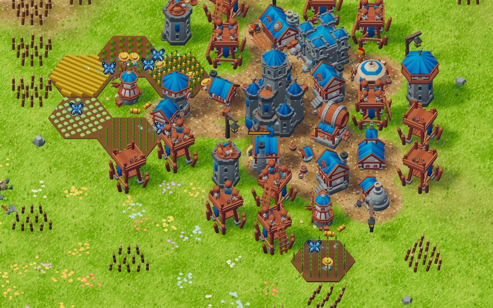
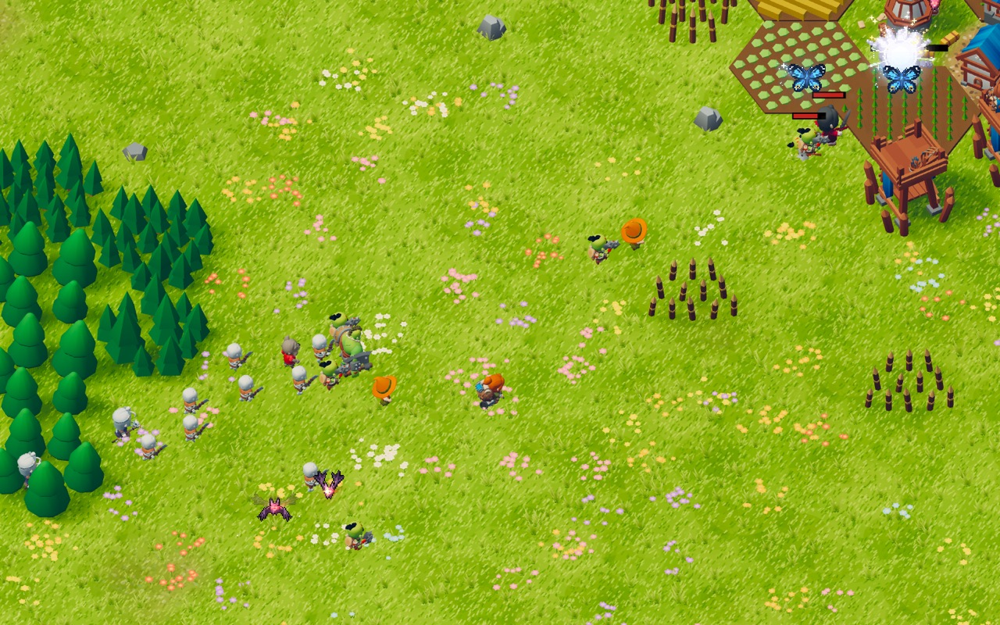
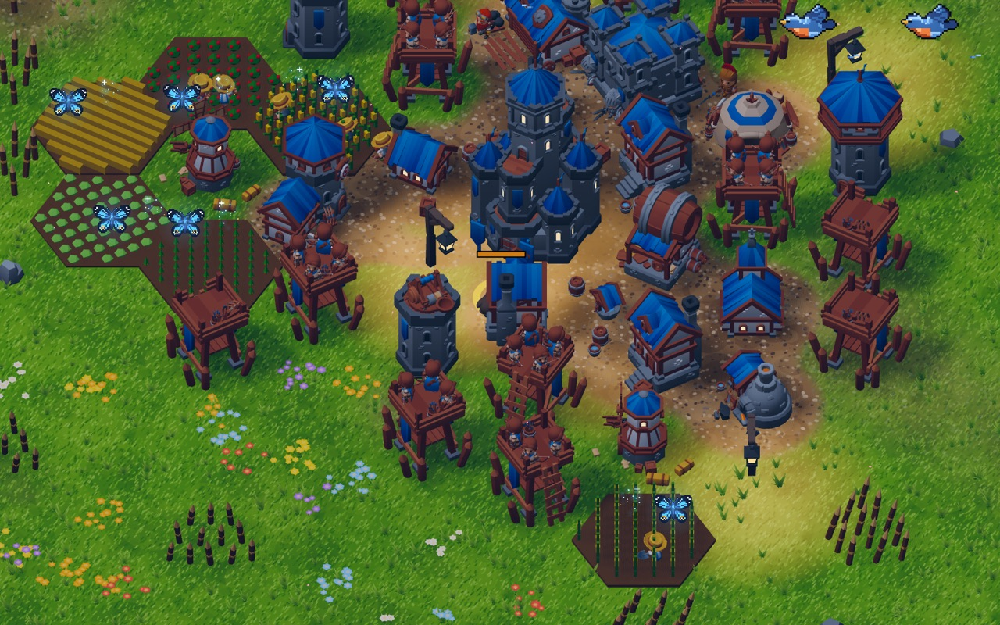
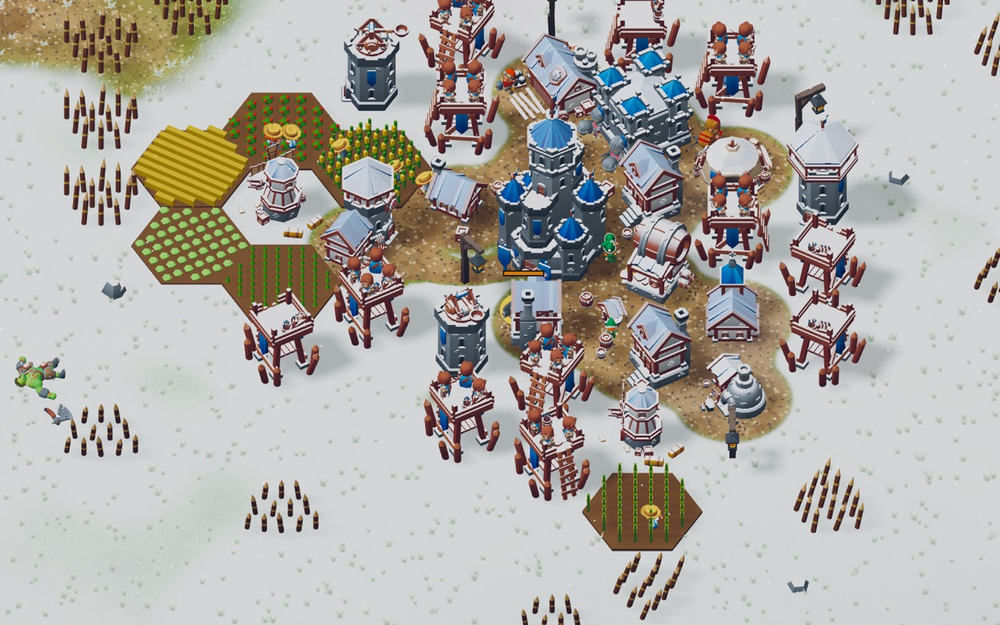
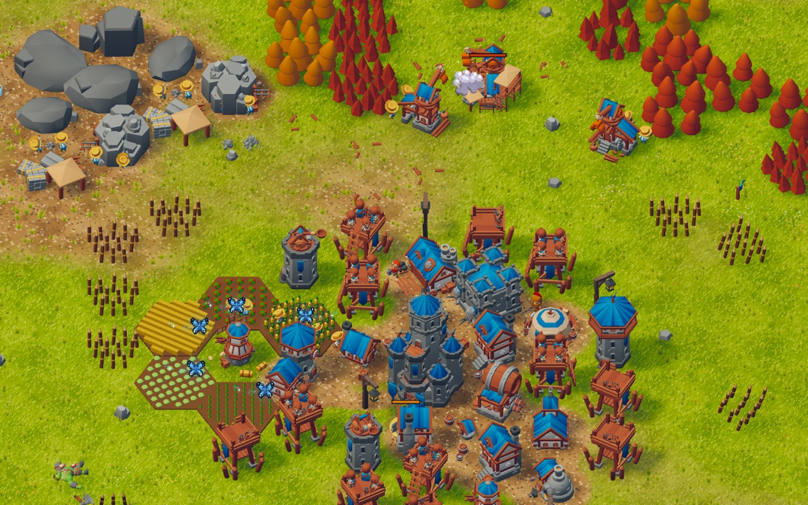

# Hordas & Hortas

**Jogar:** https://welingtonfidelis.github.io/reino-sitiado-game/

Tower defense sem fim em 2.5D isométrico, no navegador. Erga o reino em volta do castelo,
deixe os trabalhadores chegarem conforme houver casa, comida e teto, treine soldados e
arqueiros e resista às hordas que saem das fendas na beira do mapa. Até a Etapa 19 o
projeto se chamava "Reino Sitiado" (por isso o endereço e a pasta guardam esse nome).



| | |
| --- | --- |
|  |  |
|  |  |

Prints tirados do próprio jogo, numa partida já crescida (pasta `docs/prints/`).

```bash
npm install
npm run art   # arte da coleção KayKit local
npm run dev
```

Repositório: https://github.com/welingtonfidelis/reino-sitiado-game

A página é publicada sozinha a cada push na `main` (`.github/workflows/pages.yml`). Para ver a
build como ela fica lá: `npm run build -- --base=/reino-sitiado-game/` e
`npm run preview -- --base=/reino-sitiado-game/`.

Tudo sobre o jogo (decisões, regras, arquitetura e etapas) está em `docs/REINO-SITIADO.md`.
O ícone está em `public/icons/` e o manifesto (nome e ícone na tela inicial) em
`public/manifest.webmanifest`.
